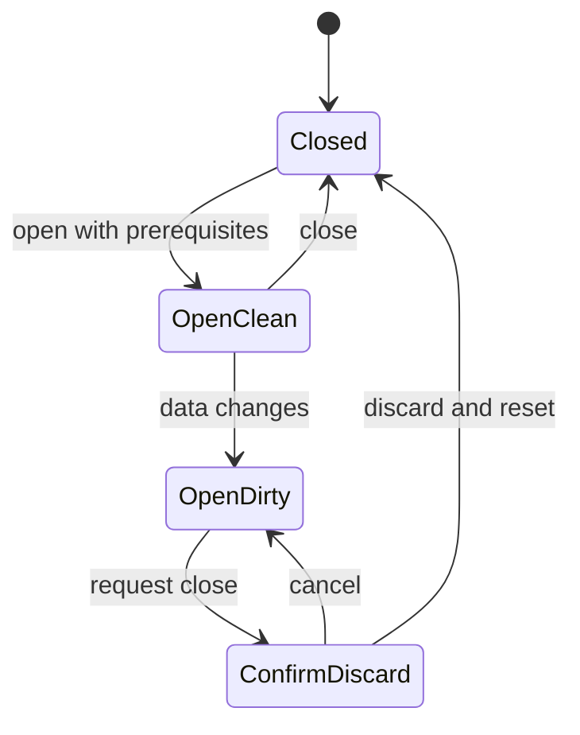

# TrainPace state-machine inventory

Static audit of `aleexwong/trainpace` at `cffee3b9a9ffe02e4183118f5256be5be77e43e0`. Source links are pinned to that commit so the evidence remains stable as the code changes.

An **implicit machine** is a lifecycle or mode whose next behavior depends on remembered flags, nullable data, effects, callbacks, timers, refs, URL parameters, or stored markers. State names below are inferred from the implementation. Independent concerns are separate rows; repeated small implementations are grouped and explicitly identified. Row counts are inventory groupings, not a claim that there is one uniquely correct decomposition into machines.

Scope: first-party runtime code in `vite-project/src` (266 TypeScript/TSX files), route composition in `App.tsx`/`main.tsx`, Firestore rules, and the video source. Stateful candidates were searched repository-wide, then handlers, effects, call sites and persistence paths were read. Third-party Firebase/React/Radix/Workbox internals, ordinary form field values, pure numeric calculations, test harness state and build-script sequencing are outside the workflow count. Partly explicit controllers, simple UI modes, dormant implementations and algorithmic scanners are distinguished below. No application behavior was changed or runtime reproduction performed.

The most valuable extraction candidates are the guest-save continuations, training-plan identity/progress/editing, GPX upload/reanalysis, AI refinement, and poster readiness/export. Small disclosure toggles do not need a state-machine library just because they appear here.

## Transition gaps found during the audit

These findings follow from source control flow; they are not claims of browser-tested failures.

1. **Pace guest saves return to an unregistered route.** [features/pace-calculator/hooks/usePacePlanPersistence.ts](https://github.com/aleexwong/trainpace/blob/cffee3b9a9ffe02e4183118f5256be5be77e43e0/vite-project/src/features/pace-calculator/hooks/usePacePlanPersistence.ts#L56) stores the pending plan and returns to `/pace-calculator`; [App.tsx](https://github.com/aleexwong/trainpace/blob/cffee3b9a9ffe02e4183118f5256be5be77e43e0/vite-project/src/App.tsx#L59) registers `/calculator`. The wildcard renders Landing, so the pace calculator’s pending-save consumer is not reached by that continuation.
2. **Starting another training plan retains the previous saved identity.** [features/plan/hooks/usePlanGenerator.ts](https://github.com/aleexwong/trainpace/blob/cffee3b9a9ffe02e4183118f5256be5be77e43e0/vite-project/src/features/plan/hooks/usePlanGenerator.ts#L52) resets the generator, while [features/plan/hooks/useSavePlan.ts](https://github.com/aleexwong/trainpace/blob/cffee3b9a9ffe02e4183118f5256be5be77e43e0/vite-project/src/features/plan/hooks/useSavePlan.ts#L29) has no reset API. [features/plan/components/TrainingPlanGenerator.tsx](https://github.com/aleexwong/trainpace/blob/cffee3b9a9ffe02e4183118f5256be5be77e43e0/vite-project/src/features/plan/components/TrainingPlanGenerator.tsx#L102) and the editor use that retained savedId. Save plan A → Start over → generate B can show B as saved and direct B’s progress/schedule writes to A. The autoSaveAttempted latch is also never reset for a new draft during the same mount.
3. **Fresh-upload reanalysis results are discarded.** [pages/ElevationPageV2.tsx](https://github.com/aleexwong/trainpace/blob/cffee3b9a9ffe02e4183118f5256be5be77e43e0/vite-project/src/pages/ElevationPageV2.tsx#L144) only applies a returned result for shared routes. The fresh-upload hook exposes no analysis-result setter; the comment saying the hook manages it does not perform that transition. Settings are updated before success, so identical retries can also take the unchanged-settings no-op path after a failure.
4. **Pending pace/fuel saves have no claim or idempotency mechanism.** [hooks/usePendingPacePlan.ts](https://github.com/aleexwong/trainpace/blob/cffee3b9a9ffe02e4183118f5256be5be77e43e0/vite-project/src/hooks/usePendingPacePlan.ts#L15) and [hooks/usePendingFuelPlan.ts](https://github.com/aleexwong/trainpace/blob/cffee3b9a9ffe02e4183118f5256be5be77e43e0/vite-project/src/hooks/usePendingFuelPlan.ts#L15) read a marker, await addDoc, then clear it. Repeated effect execution can write duplicate documents. Development [main.tsx](https://github.com/aleexwong/trainpace/blob/cffee3b9a9ffe02e4183118f5256be5be77e43e0/vite-project/src/main.tsx#L10) makes effect replay particularly relevant; Register and the fuel page both mount the fuel consumer. On failure the pending draft is discarded rather than retained for retry.
5. **Overlapping schedule writes can roll back newer local work.** [features/plan/hooks/usePlanEditor.ts](https://github.com/aleexwong/trainpace/blob/cffee3b9a9ffe02e4183118f5256be5be77e43e0/vite-project/src/features/plan/hooks/usePlanEditor.ts#L53) captures whole previous snapshots, with no pending flag or operation version. If move A fails after move B has been applied, A’s rejection restores the pre-A plan and completion map. Atomic Firestore writes protect each individual move, not the ordering of independent requests or the local rollback.
6. **Stale async responses can replace newer route/account state.** [features/elevation/hooks/useRouteLoader.ts](https://github.com/aleexwong/trainpace/blob/cffee3b9a9ffe02e4183118f5256be5be77e43e0/vite-project/src/features/elevation/hooks/useRouteLoader.ts#L109) and the four dashboard loaders have no cancellation or generation guard. Navigate from route A to B (or change the hook’s user ID) before A’s request finishes and A can publish last. PreviewRoute and useRaceGuide already demonstrate cancellation patterns elsewhere in this repository.
7. **Saved-pace-plan edit failures close the dialog as though save resolved.** [pages/DashboardV2.tsx](https://github.com/aleexwong/trainpace/blob/cffee3b9a9ffe02e4183118f5256be5be77e43e0/vite-project/src/pages/DashboardV2.tsx#L173) catches the write error without rethrowing; [components/EditPlanDialog.tsx](https://github.com/aleexwong/trainpace/blob/cffee3b9a9ffe02e4183118f5256be5be77e43e0/vite-project/src/components/EditPlanDialog.tsx#L53) then runs onClose. The route-slug editor’s parent correctly rethrows to preserve the editor on failure.
8. **Poster readiness compresses several resource states into one flag.** [features/poster/hooks/useMapbox.ts](https://github.com/aleexwong/trainpace/blob/cffee3b9a9ffe02e4183118f5256be5be77e43e0/vite-project/src/features/poster/hooks/useMapbox.ts#L39) sets ready at initial load but does not clear it during style replacement or map recreation/cleanup. [features/poster/hooks/useMapbox.ts](https://github.com/aleexwong/trainpace/blob/cffee3b9a9ffe02e4183118f5256be5be77e43e0/vite-project/src/features/poster/hooks/useMapbox.ts#L304) can wait for idle indefinitely, while [features/poster/hooks/usePosterGenerator.ts](https://github.com/aleexwong/trainpace/blob/cffee3b9a9ffe02e4183118f5256be5be77e43e0/vite-project/src/features/poster/hooks/usePosterGenerator.ts#L47) keeps export pending. Loading, restyling, blocked, failed, ready and disposed deserve distinct states and bounded waiting.

## Inventory

The tables contain 54 workflow/resource families, 4 explicit or partly explicit controllers, 18 small UI/animation families, 6 older/compatibility groups, and 4 algorithmic/timeline groups. Multiple instances are grouped where noted.

The poster dialog is a compact example of a machine currently represented by three booleans:

### Authentication and account workflows

| Machine / family | States, transitions, and guards | Source |
|---|---|---|
| Auth session and analytics identity | `loading + user + prevUidRef`: resolving → anonymous / authenticated; authenticated → anonymous resets PostHog identity. A separate listener repeats session resolution in the layout. | [features/auth/AuthContext.tsx](https://github.com/aleexwong/trainpace/blob/cffee3b9a9ffe02e4183118f5256be5be77e43e0/vite-project/src/features/auth/AuthContext.tsx#L17); [components/layout/MainLayout.tsx](https://github.com/aleexwong/trainpace/blob/cffee3b9a9ffe02e4183118f5256be5be77e43e0/vite-project/src/components/layout/MainLayout.tsx#L21) |
| Protected-route access and return navigation | Resolving → loading view; anonymous → fallback or login with returnTo; authenticated → protected content. URL query parameters carry the continuation. | [features/auth/AuthGuard.tsx](https://github.com/aleexwong/trainpace/blob/cffee3b9a9ffe02e4183118f5256be5be77e43e0/vite-project/src/features/auth/AuthGuard.tsx#L14) |
| Email sign-in | Editing → submitting → error / authenticated → validated returnTo or dashboard. The auth observer, rather than the submit handler, completes navigation. | [pages/Login.tsx](https://github.com/aleexwong/trainpace/blob/cffee3b9a9ffe02e4183118f5256be5be77e43e0/vite-project/src/pages/Login.tsx#L56) |
| Google popup sign-in | Idle → popup pending → authenticated / cancelled / blocked / failed → idle. The popup handler and Login page effect both participate in post-auth navigation. | [features/auth/LoginButton.tsx](https://github.com/aleexwong/trainpace/blob/cffee3b9a9ffe02e4183118f5256be5be77e43e0/vite-project/src/features/auth/LoginButton.tsx#L15) |
| Registration and first-run routing | Invalid / valid form → account creation → profile update → success delay → returnTo or onboarding; failures surface a toast. React Hook Form owns validation/submission state; a partial account creation can precede a profile-update failure. | [components/login/Register.tsx](https://github.com/aleexwong/trainpace/blob/cffee3b9a9ffe02e4183118f5256be5be77e43e0/vite-project/src/components/login/Register.tsx#L73) |
| Password reset request | Editing → request pending (not represented by a flag) → sent / error. Settings has a second reset-request implementation using shared isLoading. | [components/login/ResetPassword.tsx](https://github.com/aleexwong/trainpace/blob/cffee3b9a9ffe02e4183118f5256be5be77e43e0/vite-project/src/components/login/ResetPassword.tsx#L23); [pages/Settings.tsx](https://github.com/aleexwong/trainpace/blob/cffee3b9a9ffe02e4183118f5256be5be77e43e0/vite-project/src/pages/Settings.tsx#L80) |
| Sign-out | Authenticated → sign-out pending → redirected; Settings/layout catch failures, while the logout route only handles resolution. | [components/login/Logout.tsx](https://github.com/aleexwong/trainpace/blob/cffee3b9a9ffe02e4183118f5256be5be77e43e0/vite-project/src/components/login/Logout.tsx#L2); [pages/Settings.tsx](https://github.com/aleexwong/trainpace/blob/cffee3b9a9ffe02e4183118f5256be5be77e43e0/vite-project/src/pages/Settings.tsx#L46) |
| Display-name editing | Viewing → editing → updating → viewing with new name; cancel restores the name; failure restores input and reports an error. Shares isLoading with other Settings operations. | [pages/Settings.tsx](https://github.com/aleexwong/trainpace/blob/cffee3b9a9ffe02e4183118f5256be5be77e43e0/vite-project/src/pages/Settings.tsx#L56) |
| Account deletion | Idle → confirmation → provider-dependent reauthentication → parallel Firestore cleanup → auth-user deletion → home; failure → error and cleared confirmation/password. Cleanup can partially succeed; no durable resume marker exists. | [pages/Settings.tsx](https://github.com/aleexwong/trainpace/blob/cffee3b9a9ffe02e4183118f5256be5be77e43e0/vite-project/src/pages/Settings.tsx#L131); [pages/Settings.tsx](https://github.com/aleexwong/trainpace/blob/cffee3b9a9ffe02e4183118f5256be5be77e43e0/vite-project/src/pages/Settings.tsx#L96) |
| Goal-profile loading and persistence | `goals + loading + error`: no user / loading → absent / loaded / error; save creates or merges, then updates local goals. isFirstSave is inferred from goals === null. | [features/goals/hooks/useTrainingGoals.ts](https://github.com/aleexwong/trainpace/blob/cffee3b9a9ffe02e4183118f5256be5be77e43e0/vite-project/src/features/goals/hooks/useTrainingGoals.ts#L16) |
| Goal onboarding / editing wizard | Load existing profile → recent race → target race → integration selection → saving → dashboard; back/skip/failure paths. Step transitions have form-validity guards and completion is persisted as onboardingCompleted. | [features/goals/components/OnboardingFlow.tsx](https://github.com/aleexwong/trainpace/blob/cffee3b9a9ffe02e4183118f5256be5be77e43e0/vite-project/src/features/goals/components/OnboardingFlow.tsx#L61) |

### Calculation, AI, and plan-saving workflows

| Machine / family | States, transitions, and guards | Source |
|---|---|---|
| Pace calculator | `results + errors + isCalculating + autoCalc`: editing → invalid / calculated; suggested-time chips and share links trigger automatic calculation; edit returns to input mode. Result/unit updates and save status are separate state owners. | [features/pace-calculator/components/PaceCalculatorV2.tsx](https://github.com/aleexwong/trainpace/blob/cffee3b9a9ffe02e4183118f5256be5be77e43e0/vite-project/src/features/pace-calculator/components/PaceCalculatorV2.tsx#L50) |
| Pace-plan save | `isSaving + isSaved + showSaveDialog`: result → metadata dialog → saving → saved / failure; guest → sessionStorage handoff. The dialog blocks close while saving; parent closes after the persistence hook resolves, including caught failures. Error is a toast rather than a persistent state. | [features/pace-calculator/hooks/usePacePlanPersistence.ts](https://github.com/aleexwong/trainpace/blob/cffee3b9a9ffe02e4183118f5256be5be77e43e0/vite-project/src/features/pace-calculator/hooks/usePacePlanPersistence.ts#L35); [features/pace-calculator/components/PaceCalculatorV2.tsx](https://github.com/aleexwong/trainpace/blob/cffee3b9a9ffe02e4183118f5256be5be77e43e0/vite-project/src/features/pace-calculator/components/PaceCalculatorV2.tsx#L292); [features/pace-calculator/components/SavePlanDialog.tsx](https://github.com/aleexwong/trainpace/blob/cffee3b9a9ffe02e4183118f5256be5be77e43e0/vite-project/src/features/pace-calculator/components/SavePlanDialog.tsx#L40) |
| Pace-plan guest continuation | pending_pace_plan + savePlan=true + authenticated user → addDoc → clear pending data → delayed dashboard redirect; failure also clears pending data. No claimed/in-flight marker or idempotency key. | [hooks/usePendingPacePlan.ts](https://github.com/aleexwong/trainpace/blob/cffee3b9a9ffe02e4183118f5256be5be77e43e0/vite-project/src/hooks/usePendingPacePlan.ts#L15) |
| VDOT calculator and history restoration | Editing / validation errors → calculated result plus persisted bounded history; reset → blank; history selection → prefilled but uncalculated; pace-unit toggle rewrites result predictions. | [features/vdot-calculator/hooks/useVdotCalculator.ts](https://github.com/aleexwong/trainpace/blob/cffee3b9a9ffe02e4183118f5256be5be77e43e0/vite-project/src/features/vdot-calculator/hooks/useVdotCalculator.ts#L182) |
| Fuel calculator | Editing → invalid-input toast / result; edit clears result, advice, time fields, saved state, and feedback. customCarbsPerHour adds automatic / manual-override modes; race changes restore automatic mode. | [features/fuel/components/FuelPlannerV2.tsx](https://github.com/aleexwong/trainpace/blob/cffee3b9a9ffe02e4183118f5256be5be77e43e0/vite-project/src/features/fuel/components/FuelPlannerV2.tsx#L56) |
| AI recommendations and cooldown | `recommendations + isRefining + cooldownSeconds`: no advice → refining → advice with cooldown / error; timer → available again; reset clears advice. UI guards refinement during cooldown, but the hook itself only checks planContext. | [features/fuel/hooks/useAIRecommendations.ts](https://github.com/aleexwong/trainpace/blob/cffee3b9a9ffe02e4183118f5256be5be77e43e0/vite-project/src/features/fuel/hooks/useAIRecommendations.ts#L37); [features/fuel/components/AIPersonalization.tsx](https://github.com/aleexwong/trainpace/blob/cffee3b9a9ffe02e4183118f5256be5be77e43e0/vite-project/src/features/fuel/components/AIPersonalization.tsx#L208) |
| AI HTTP request | Context validation → optional auth-token acquisition (failure falls back to anonymous) → request → success / HTTP failure / 20-second abort; structured response returns to the recommendation hook. Timeout covers fetch until headers, not JSON-body parsing. | [services/gemini.ts](https://github.com/aleexwong/trainpace/blob/cffee3b9a9ffe02e4183118f5256be5be77e43e0/vite-project/src/services/gemini.ts#L82) |
| Fuel-plan save | `isSaving + isSaved`: unsaved → saving → saved / failure; guest → sessionStorage plus registration redirect. AI reset and edit reset the saved flag. | [features/fuel/hooks/useFuelPlanPersistence.ts](https://github.com/aleexwong/trainpace/blob/cffee3b9a9ffe02e4183118f5256be5be77e43e0/vite-project/src/features/fuel/hooks/useFuelPlanPersistence.ts#L43) |
| Fuel-plan guest continuation | pending_fuel_plan + savePlan=true + user → addDoc → clear → delayed dashboard; failure discards pending data. Mounted by both Register and the active fuel calculator. | [hooks/usePendingFuelPlan.ts](https://github.com/aleexwong/trainpace/blob/cffee3b9a9ffe02e4183118f5256be5be77e43e0/vite-project/src/hooks/usePendingFuelPlan.ts#L15); [components/login/Register.tsx](https://github.com/aleexwong/trainpace/blob/cffee3b9a9ffe02e4183118f5256be5be77e43e0/vite-project/src/components/login/Register.tsx#L60); [features/fuel/components/FuelPlannerV2.tsx](https://github.com/aleexwong/trainpace/blob/cffee3b9a9ffe02e4183118f5256be5be77e43e0/vite-project/src/features/fuel/components/FuelPlannerV2.tsx#L46) |
| AI personalization presentation | Context entry / preset selection → refine → slide zero; recommendations switch between carousel and list; reset clears context, presets, slide and list mode. feedbackGiven forms a separate unreviewed → reviewed latch in the parent. | [features/fuel/components/AIPersonalization.tsx](https://github.com/aleexwong/trainpace/blob/cffee3b9a9ffe02e4183118f5256be5be77e43e0/vite-project/src/features/fuel/components/AIPersonalization.tsx#L47); [features/fuel/components/FuelPlannerV2.tsx](https://github.com/aleexwong/trainpace/blob/cffee3b9a9ffe02e4183118f5256be5be77e43e0/vite-project/src/features/fuel/components/FuelPlannerV2.tsx#L226) |

### Training-plan workflows

| Machine / family | States, transitions, and guards | Source |
|---|---|---|
| Draft generation and restoration | No draft / valid restored draft → validate → generated and persisted draft / error; expired draft is discarded at load; reset clears plan and pending-save flag while retaining form inputs. PlanInputForm owns controlled race/date/fitness/day/time values and submits a snapshot. | [features/plan/hooks/usePlanGenerator.ts](https://github.com/aleexwong/trainpace/blob/cffee3b9a9ffe02e4183118f5256be5be77e43e0/vite-project/src/features/plan/hooks/usePlanGenerator.ts#L13); [features/plan/utils/planPersistence.ts](https://github.com/aleexwong/trainpace/blob/cffee3b9a9ffe02e4183118f5256be5be77e43e0/vite-project/src/features/plan/utils/planPersistence.ts#L44); [features/plan/components/PlanInputForm.tsx](https://github.com/aleexwong/trainpace/blob/cffee3b9a9ffe02e4183118f5256be5be77e43e0/vite-project/src/features/plan/components/PlanInputForm.tsx#L60) |
| Training-plan save and account ownership | `saving + savedId + error`: draft → saving → saved; permission-denied retries under a fresh document ID; failure remains retryable. Document IDs make normal repeated saves idempotent; createdAt/savedId infer first save vs update. | [features/plan/hooks/useSavePlan.ts](https://github.com/aleexwong/trainpace/blob/cffee3b9a9ffe02e4183118f5256be5be77e43e0/vite-project/src/features/plan/hooks/useSavePlan.ts#L28) |
| Training-plan guest continuation and storage promotion | Draft → pending-save localStorage flag → login → restore + auth resolved → one auto-save attempt → clear draft/flag/guest ticks. savedId promotes later progress/edit writes from localStorage to Firestore. | [features/plan/components/TrainingPlanGenerator.tsx](https://github.com/aleexwong/trainpace/blob/cffee3b9a9ffe02e4183118f5256be5be77e43e0/vite-project/src/features/plan/components/TrainingPlanGenerator.tsx#L169) |
| Workout completion (one machine per workout) | Incomplete ↔ complete; guest writes locally; saved plan optimistically toggles → pending → committed / prior-value rollback with error. completed and pending maps jointly encode the states. | [features/plan/hooks/usePlanProgress.ts](https://github.com/aleexwong/trainpace/blob/cffee3b9a9ffe02e4183118f5256be5be77e43e0/vite-project/src/features/plan/hooks/usePlanProgress.ts#L70) |
| Drag interaction | Idle → dragging a day → drop or cancel → idle. Invalid moves, race-day moves and moves after the race are rejected; a valid drop requests a move/swap. | [features/plan/components/PlanCalendarGrid.tsx](https://github.com/aleexwong/trainpace/blob/cffee3b9a9ffe02e4183118f5256be5be77e43e0/vite-project/src/features/plan/components/PlanCalendarGrid.tsx#L232); [features/plan/utils/planEdit.ts](https://github.com/aleexwong/trainpace/blob/cffee3b9a9ffe02e4183118f5256be5be77e43e0/vite-project/src/features/plan/utils/planEdit.ts#L32) |
| Schedule persistence and completion-key migration | Current schedule → optimistic move/swap plus migrated completion map → local persist / remote commit; remote failure restores the captured plan and completion map. No pending/version state serializes overlapping moves. | [features/plan/hooks/usePlanEditor.ts](https://github.com/aleexwong/trainpace/blob/cffee3b9a9ffe02e4183118f5256be5be77e43e0/vite-project/src/features/plan/hooks/usePlanEditor.ts#L47) |
| Plan view and one-time calendar positioning | Plan absent / future / current / past derives the default schedule/this-week view; explicit user segment overrides it; a new plan resets that choice. Calendar activation → one auto-scroll per mount; schedule edits preserve segment identity. | [features/plan/components/TrainingPlanGenerator.tsx](https://github.com/aleexwong/trainpace/blob/cffee3b9a9ffe02e4183118f5256be5be77e43e0/vite-project/src/features/plan/components/TrainingPlanGenerator.tsx#L119); [features/plan/components/PlanCalendar.tsx](https://github.com/aleexwong/trainpace/blob/cffee3b9a9ffe02e4183118f5256be5be77e43e0/vite-project/src/features/plan/components/PlanCalendar.tsx#L30) |
| Date-derived plan/workout lifecycle | Before plan → a current week → after plan; next workout derives upcoming incomplete / overdue incomplete / none from dates and completion keys. There is no clock subscription: transitions become visible when recomputed, not automatically at midnight. | [features/plan/utils/planSchedule.ts](https://github.com/aleexwong/trainpace/blob/cffee3b9a9ffe02e4183118f5256be5be77e43e0/vite-project/src/features/plan/utils/planSchedule.ts#L95); [features/plan/utils/planSchedule.ts](https://github.com/aleexwong/trainpace/blob/cffee3b9a9ffe02e4183118f5256be5be77e43e0/vite-project/src/features/plan/utils/planSchedule.ts#L119) |

### GPX, route, and dashboard workflows

| Machine / family | States, transitions, and guards | Source |
|---|---|---|
| Upload admission / quota | Anonymous → login required; authenticated → quota check → allowed / hourly-or-daily blocked. Counts refresh on user changes and after uploads; passing time alone does not reset the UI flag. | [components/elevationfinder/GpxUploader.tsx](https://github.com/aleexwong/trainpace/blob/cffee3b9a9ffe02e4183118f5256be5be77e43e0/vite-project/src/components/elevationfinder/GpxUploader.tsx#L80) |
| GPX upload pipeline | Idle → file read → XML validation → hash → duplicate lookup → upload storage → write metadata → refresh quota → handoff to analysis → idle; errors toast and reset progress. Numeric progress is a phase marker, not byte progress. | [components/elevationfinder/GpxUploader.tsx](https://github.com/aleexwong/trainpace/blob/cffee3b9a9ffe02e4183118f5256be5be77e43e0/vite-project/src/components/elevationfinder/GpxUploader.tsx#L488); [components/elevationfinder/GpxUploader.tsx](https://github.com/aleexwong/trainpace/blob/cffee3b9a9ffe02e4183118f5256be5be77e43e0/vite-project/src/components/elevationfinder/GpxUploader.tsx#L445) |
| Duplicate resolution | `duplicateFound + pendingUpload`: duplicate detected → awaiting decision → reuse existing / upload fresh copy / cancel. Existing content resolves from inline content, storage reference, or direct URL, with a new metadata document on the final path. | [components/elevationfinder/GpxUploader.tsx](https://github.com/aleexwong/trainpace/blob/cffee3b9a9ffe02e4183118f5256be5be77e43e0/vite-project/src/components/elevationfinder/GpxUploader.tsx#L323) |
| Fresh-upload analysis | `loading + error + filename + points + analysisData + originalGpxText`: parsed → analyzing → result / error; reset clears all. Share URL changes before analysis; the real upload ID is copied to the page only on success. | [features/elevation/hooks/useFileUpload.ts](https://github.com/aleexwong/trainpace/blob/cffee3b9a9ffe02e4183118f5256be5be77e43e0/vite-project/src/features/elevation/hooks/useFileUpload.ts#L58) |
| Shared-route resolution and analysis | URL migration → slug/shortId lookup → legacy document fallback → metadata → cache hit / retrieve GPX and analyze → loaded / error. URL routeId is the effect trigger; no cancellation or request-generation guard. | [features/elevation/hooks/useRouteLoader.ts](https://github.com/aleexwong/trainpace/blob/cffee3b9a9ffe02e4183118f5256be5be77e43e0/vite-project/src/features/elevation/hooks/useRouteLoader.ts#L109); [pages/ElevationPageV2.tsx](https://github.com/aleexwong/trainpace/blob/cffee3b9a9ffe02e4183118f5256be5be77e43e0/vite-project/src/pages/ElevationPageV2.tsx#L113) |
| Analysis cache lifecycle | Absent / expired / valid entry → miss / delete expired / reconstruct response; API success attempts static-data and analysis-cache writes. Read/cleanup/write failures degrade to misses or uncached results; creator-only cache permissions affect who can replace entries. | [features/elevation/hooks/useGpxAnalysis.ts](https://github.com/aleexwong/trainpace/blob/cffee3b9a9ffe02e4183118f5256be5be77e43e0/vite-project/src/features/elevation/hooks/useGpxAnalysis.ts#L55); [firestore.rules](https://github.com/aleexwong/trainpace/blob/cffee3b9a9ffe02e4183118f5256be5be77e43e0/firestore.rules#L43) |
| Settings reanalysis and throttles | Live local slider values → release (2-second gate) → unchanged no-op / cache lookup / source retrieval / API request → result / error. A second lastApiCall gate protects API calls. Page updates selected settings before reanalysis finishes. | [features/elevation/components/SettingsPanel.tsx](https://github.com/aleexwong/trainpace/blob/cffee3b9a9ffe02e4183118f5256be5be77e43e0/vite-project/src/features/elevation/components/SettingsPanel.tsx#L33); [features/elevation/hooks/useGpxAnalysis.ts](https://github.com/aleexwong/trainpace/blob/cffee3b9a9ffe02e4183118f5256be5be77e43e0/vite-project/src/features/elevation/hooks/useGpxAnalysis.ts#L251); [pages/ElevationPageV2.tsx](https://github.com/aleexwong/trainpace/blob/cffee3b9a9ffe02e4183118f5256be5be77e43e0/vite-project/src/pages/ElevationPageV2.tsx#L130) |
| Elevation data-source orchestration | No route → fresh upload or shared URL → results; Upload New clears both sources and navigates to the uploader. isSharedRoute selects which hook owns visible data, errors, and loading; URL, uploadDocId and resolvedDocId encode different identities. | [pages/ElevationPageV2.tsx](https://github.com/aleexwong/trainpace/blob/cffee3b9a9ffe02e4183118f5256be5be77e43e0/vite-project/src/pages/ElevationPageV2.tsx#L83); [pages/ElevationPageV2.tsx](https://github.com/aleexwong/trainpace/blob/cffee3b9a9ffe02e4183118f5256be5be77e43e0/vite-project/src/pages/ElevationPageV2.tsx#L157) |
| Route filename editing | Viewing → editing → updating → viewing; Enter saves, Escape cancels; failure resets input and exits edit mode. Ownership/doc ID guard writes. | [components/elevationfinder/ElevationChart.tsx](https://github.com/aleexwong/trainpace/blob/cffee3b9a9ffe02e4183118f5256be5be77e43e0/vite-project/src/components/elevationfinder/ElevationChart.tsx#L88) |
| Bookmark toggle | `checking + loading + isSaved`: lookup → saved / unsaved → removing / saving → updated state / error. Anonymous click reports sign-in requirement; deterministic doc ID makes repeated sets target one bookmark. | [components/SavePreviewRouteButton.tsx](https://github.com/aleexwong/trainpace/blob/cffee3b9a9ffe02e4183118f5256be5be77e43e0/vite-project/src/components/SavePreviewRouteButton.tsx#L50) |
| Dashboard resource loading (four instances) | Initial/no-user → loading → loaded empty / loaded populated / error; reload repeats. Implementations retain data and errors independently and lack stale-response cancellation. Routes combine uploads and bookmarks; the others load pace, fuel, and training plans. | [features/dashboard/hooks/useRoutes.ts](https://github.com/aleexwong/trainpace/blob/cffee3b9a9ffe02e4183118f5256be5be77e43e0/vite-project/src/features/dashboard/hooks/useRoutes.ts#L13); [features/dashboard/hooks/usePacePlans.ts](https://github.com/aleexwong/trainpace/blob/cffee3b9a9ffe02e4183118f5256be5be77e43e0/vite-project/src/features/dashboard/hooks/usePacePlans.ts#L13); [features/dashboard/hooks/useFuelPlans.ts](https://github.com/aleexwong/trainpace/blob/cffee3b9a9ffe02e4183118f5256be5be77e43e0/vite-project/src/features/dashboard/hooks/useFuelPlans.ts#L13); [features/dashboard/hooks/useTrainingPlans.ts](https://github.com/aleexwong/trainpace/blob/cffee3b9a9ffe02e4183118f5256be5be77e43e0/vite-project/src/features/dashboard/hooks/useTrainingPlans.ts#L7) |
| Dashboard deletion and persistent route tombstone | Viewing → confirmation where supplied → delete request → remove from local list / error. Uploaded routes persist deleted=true; bookmarks and plans are hard-deleted. No shared deletion-pending state exists. | [features/dashboard/actions.ts](https://github.com/aleexwong/trainpace/blob/cffee3b9a9ffe02e4183118f5256be5be77e43e0/vite-project/src/features/dashboard/actions.ts#L61); [features/dashboard/components/RouteCard.tsx](https://github.com/aleexwong/trainpace/blob/cffee3b9a9ffe02e4183118f5256be5be77e43e0/vite-project/src/features/dashboard/components/RouteCard.tsx#L56); [features/dashboard/components/TrainingPlanCard.tsx](https://github.com/aleexwong/trainpace/blob/cffee3b9a9ffe02e4183118f5256be5be77e43e0/vite-project/src/features/dashboard/components/TrainingPlanCard.tsx#L17); [pages/DashboardV2.tsx](https://github.com/aleexwong/trainpace/blob/cffee3b9a9ffe02e4183118f5256be5be77e43e0/vite-project/src/pages/DashboardV2.tsx#L82) |
| Route URL editing / legacy URL upgrade | Viewing → editor seeded from current slug → saving → new share URL / remain editing on failure. Existing shortId survives; legacy routes get one on first edit. | [features/dashboard/components/RouteCard.tsx](https://github.com/aleexwong/trainpace/blob/cffee3b9a9ffe02e4183118f5256be5be77e43e0/vite-project/src/features/dashboard/components/RouteCard.tsx#L77); [features/dashboard/actions.ts](https://github.com/aleexwong/trainpace/blob/cffee3b9a9ffe02e4183118f5256be5be77e43e0/vite-project/src/features/dashboard/actions.ts#L22) |
| Saved pace-plan editing | Closed → open with initialized metadata → saving → close on resolution / remain open on rejection. Parent catches update failures without rethrowing, so the actual composed flow closes after a failed write too. | [components/EditPlanDialog.tsx](https://github.com/aleexwong/trainpace/blob/cffee3b9a9ffe02e4183118f5256be5be77e43e0/vite-project/src/components/EditPlanDialog.tsx#L50); [pages/DashboardV2.tsx](https://github.com/aleexwong/trainpace/blob/cffee3b9a9ffe02e4183118f5256be5be77e43e0/vite-project/src/pages/DashboardV2.tsx#L173) |
| Race data enhancement (three implementations) | Bundled fallback → Firestore lookup → enhanced geometry/stats / retain fallback. PreviewRoute tracks loading/error; RaceSeoLanding uses pointsPending to delay map spending; RaceIndex tracks fallback/firebase source. Effect cleanup suppresses stale async results. | [pages/PreviewRoute.tsx](https://github.com/aleexwong/trainpace/blob/cffee3b9a9ffe02e4183118f5256be5be77e43e0/vite-project/src/pages/PreviewRoute.tsx#L106); [pages/RaceSeoLanding.tsx](https://github.com/aleexwong/trainpace/blob/cffee3b9a9ffe02e4183118f5256be5be77e43e0/vite-project/src/pages/RaceSeoLanding.tsx#L70); [pages/RaceIndex.tsx](https://github.com/aleexwong/trainpace/blob/cffee3b9a9ffe02e4183118f5256be5be77e43e0/vite-project/src/pages/RaceIndex.tsx#L79) |
| Lazy race-guide loading | Disabled / no slug → undefined; enabled → import pending → guide / absent / failed (all but guide represented as undefined). Cancellation prevents old imports overwriting a new slug. The loader registry also initializes once on first use. | [features/seo-pages/hooks/useRaceGuide.ts](https://github.com/aleexwong/trainpace/blob/cffee3b9a9ffe02e4183118f5256be5be77e43e0/vite-project/src/features/seo-pages/hooks/useRaceGuide.ts#L10); [features/seo-pages/raceGuides.ts](https://github.com/aleexwong/trainpace/blob/cffee3b9a9ffe02e4183118f5256be5be77e43e0/vite-project/src/features/seo-pages/raceGuides.ts#L104) |

### Map and poster resource workflows

| Machine / family | States, transitions, and guards | Source |
|---|---|---|
| Mapbox CDN loader | Unrequested → shared promise pending → window.mapboxgl available; error clears the promise so another caller can retry. Script/CSS DOM nodes and module-level loadPromise jointly encode the lifecycle. | [lib/mapbox/loader.ts](https://github.com/aleexwong/trainpace/blob/cffee3b9a9ffe02e4183118f5256be5be77e43e0/vite-project/src/lib/mapbox/loader.ts#L24) |
| Request budget and storage fallback | Token absent / allowed / burst blocked / sustained blocked derive from timestamp windows. Successful consumption appends a timestamp; elapsed time reopens slots. Storage probes localStorage then sessionStorage; write failure permanently latches to memory until reset/reload. | [lib/mapbox/budget.ts](https://github.com/aleexwong/trainpace/blob/cffee3b9a9ffe02e4183118f5256be5be77e43e0/vite-project/src/lib/mapbox/budget.ts#L60); [lib/mapbox/budget.ts](https://github.com/aleexwong/trainpace/blob/cffee3b9a9ffe02e4183118f5256be5be77e43e0/vite-project/src/lib/mapbox/budget.ts#L165) |
| Map-image database and cache records | DB unopened → opening/upgrading → available / memory-only fallback; dbPromise memoizes the result, including failure. Records are missing / fresh / expired / evicted; reads refresh recency, writes populate memory and IndexedDB, TTL/count/byte caps prune entries. | [lib/mapbox/imageCache.ts](https://github.com/aleexwong/trainpace/blob/cffee3b9a9ffe02e4183118f5256be5be77e43e0/vite-project/src/lib/mapbox/imageCache.ts#L52); [lib/mapbox/imageCache.ts](https://github.com/aleexwong/trainpace/blob/cffee3b9a9ffe02e4183118f5256be5be77e43e0/vite-project/src/lib/mapbox/imageCache.ts#L92) |
| Per-key static-image request sharing | No request → shared fetch promise → cache insertion → delete inFlight entry on either outcome. Joiners reuse the request without another budget spend; component cancellation stops publication, not the shared fetch. | [lib/mapbox/useStaticRouteMap.ts](https://github.com/aleexwong/trainpace/blob/cffee3b9a9ffe02e4183118f5256be5be77e43e0/vite-project/src/lib/mapbox/useStaticRouteMap.ts#L39) |
| Static/live map presentation and retry clock | Unmeasured / awaiting final points → sketch; ready image → user opts into live GL → close returns to image. Budget block starts countdown → automatic static retry. This composes with the explicitly named static-map lifecycle below. | [components/utils/StaticRouteMap.tsx](https://github.com/aleexwong/trainpace/blob/cffee3b9a9ffe02e4183118f5256be5be77e43e0/vite-project/src/components/utils/StaticRouteMap.tsx#L72); [components/utils/StaticRouteMap.tsx](https://github.com/aleexwong/trainpace/blob/cffee3b9a9ffe02e4183118f5256be5be77e43e0/vite-project/src/components/utils/StaticRouteMap.tsx#L117) |
| Poster dialog, dirty state and discard confirmation | `isOpen + hasChanges + showConfirmClose`: closed → open → changed; close with changes → confirmation → discard closes/reset or cancel returns to editing. Feature flag, authenticated user, points and metadata gate entry. onDataChange from PosterGenerator marks the dialog changed. | [features/poster/components/PosterButton.tsx](https://github.com/aleexwong/trainpace/blob/cffee3b9a9ffe02e4183118f5256be5be77e43e0/vite-project/src/features/poster/components/PosterButton.tsx#L32) |
| Poster city lookup / geocoding fallback | Default city → lookup pending → detected city / retain default. Service checks rounded-coordinate cache → Nominatim throttle/request → budget-gated Mapbox fallback → fallback result. Timestamp throttle and cache are module state. | [features/poster/hooks/usePosterData.ts](https://github.com/aleexwong/trainpace/blob/cffee3b9a9ffe02e4183118f5256be5be77e43e0/vite-project/src/features/poster/hooks/usePosterData.ts#L62); [utils/geocoding.ts](https://github.com/aleexwong/trainpace/blob/cffee3b9a9ffe02e4183118f5256be5be77e43e0/vite-project/src/utils/geocoding.ts#L35); [utils/geocoding.ts](https://github.com/aleexwong/trainpace/blob/cffee3b9a9ffe02e4183118f5256be5be77e43e0/vite-project/src/utils/geocoding.ts#L334) |
| Poster map, style, and preview readiness | Prerequisites missing → CDN/budget → map loading → mapReady; template change → setStyle → styledata rebuilds route → idle; color/overlay updates are delayed. Cleanup removes map; mapReady does not represent style-reloading, blocked, error, or disposed states. | [features/poster/hooks/useMapbox.ts](https://github.com/aleexwong/trainpace/blob/cffee3b9a9ffe02e4183118f5256be5be77e43e0/vite-project/src/features/poster/hooks/useMapbox.ts#L39); [features/poster/components/PosterPreview.tsx](https://github.com/aleexwong/trainpace/blob/cffee3b9a9ffe02e4183118f5256be5be77e43e0/vite-project/src/features/poster/components/PosterPreview.tsx#L25) |
| Poster export | Not ready → reject; ready → generating → wait for map idle → capture canvas → render image → download → idle; exceptions → toast + idle. There is no retained error state or timeout on waiting for idle. | [features/poster/hooks/usePosterGenerator.ts](https://github.com/aleexwong/trainpace/blob/cffee3b9a9ffe02e4183118f5256be5be77e43e0/vite-project/src/features/poster/hooks/usePosterGenerator.ts#L32) |

### Explicit or partly explicit machines (kept separate)

| Machine / family | States, transitions, and guards | Source |
|---|---|---|
| Static-map request state | Explicit status union: idle → unavailable or loading → ready / blocked / error; input changes and retry counter restart it. src, blockedReason, retryAfterMs and fromCache remain independently stored; no transition reducer enforces their combinations. | [lib/mapbox/useStaticRouteMap.ts](https://github.com/aleexwong/trainpace/blob/cffee3b9a9ffe02e4183118f5256be5be77e43e0/vite-project/src/lib/mapbox/useStaticRouteMap.ts#L18) |
| Interactive map state | Explicit status union: loading → ready / blocked / error; blocked countdown enables manual retry; no-token blocks retry. Hidden map ref, loaded latch, cancellation, highlight marker and cleanup supply additional implicit resource states. | [components/utils/MapboxRoutePreview.tsx](https://github.com/aleexwong/trainpace/blob/cffee3b9a9ffe02e4183118f5256be5be77e43e0/vite-project/src/components/utils/MapboxRoutePreview.tsx#L39) |
| Toast reducer | Explicit ADD/UPDATE/DISMISS/REMOVE actions: absent → open → closed awaiting removal → removed. Global memoryState, listeners and toastTimeouts supply shared ownership/timer state; adding a new toast evicts the previous one because the limit is one. | [hooks/use-toast.ts](https://github.com/aleexwong/trainpace/blob/cffee3b9a9ffe02e4183118f5256be5be77e43e0/vite-project/src/hooks/use-toast.ts#L74) |
| Training periodization | Explicit TrainingPhase union; generation advances Base Building → Development → Sharpening → Taper → Race Week through nested loops/counters. This is a generated schedule, not a mutable runtime phase controller. | [features/plan/types.ts](https://github.com/aleexwong/trainpace/blob/cffee3b9a9ffe02e4183118f5256be5be77e43e0/vite-project/src/features/plan/types.ts#L48); [features/plan/plan-math.ts](https://github.com/aleexwong/trainpace/blob/cffee3b9a9ffe02e4183118f5256be5be77e43e0/vite-project/src/features/plan/plan-math.ts#L371) |

### Small UI and animation machines

| Machine / family | States, transitions, and guards | Source |
|---|---|---|
| Navigation visibility and mobile menu | Scroll direction/threshold → visible or hidden; hiding and route change close menu; menu close resets nested preview menu; open menu locks body scroll. | [components/layout/MainLayout.tsx](https://github.com/aleexwong/trainpace/blob/cffee3b9a9ffe02e4183118f5256be5be77e43e0/vite-project/src/components/layout/MainLayout.tsx#L22) |
| Preview dropdown | Closed → hover/click open → leave schedules close → re-entry cancels timer; outside click closes; cleanup clears timer. | [components/layout/PreviewRoutesDropdown.tsx](https://github.com/aleexwong/trainpace/blob/cffee3b9a9ffe02e4183118f5256be5be77e43e0/vite-project/src/components/layout/PreviewRoutesDropdown.tsx#L16) |
| Dashboard tabs, filtering, pagination and card expansion | activeTab selects a resource; SearchBar is typing → debounce → committed query (with keyboard handling); each resource section pages its filtered list; pace/fuel/training cards expand/collapse. | [pages/DashboardV2.tsx](https://github.com/aleexwong/trainpace/blob/cffee3b9a9ffe02e4183118f5256be5be77e43e0/vite-project/src/pages/DashboardV2.tsx#L31); [features/dashboard/components/SearchBar.tsx](https://github.com/aleexwong/trainpace/blob/cffee3b9a9ffe02e4183118f5256be5be77e43e0/vite-project/src/features/dashboard/components/SearchBar.tsx#L18); [features/dashboard/components/RoutesSection.tsx](https://github.com/aleexwong/trainpace/blob/cffee3b9a9ffe02e4183118f5256be5be77e43e0/vite-project/src/features/dashboard/components/RoutesSection.tsx#L21); [features/dashboard/components/PacePlansSection.tsx](https://github.com/aleexwong/trainpace/blob/cffee3b9a9ffe02e4183118f5256be5be77e43e0/vite-project/src/features/dashboard/components/PacePlansSection.tsx#L23); [features/dashboard/components/FuelPlansSection.tsx](https://github.com/aleexwong/trainpace/blob/cffee3b9a9ffe02e4183118f5256be5be77e43e0/vite-project/src/features/dashboard/components/FuelPlansSection.tsx#L21); [features/dashboard/components/PacePlanCard.tsx](https://github.com/aleexwong/trainpace/blob/cffee3b9a9ffe02e4183118f5256be5be77e43e0/vite-project/src/features/dashboard/components/PacePlanCard.tsx#L26); [features/dashboard/components/FuelPlanCard.tsx](https://github.com/aleexwong/trainpace/blob/cffee3b9a9ffe02e4183118f5256be5be77e43e0/vite-project/src/features/dashboard/components/FuelPlanCard.tsx#L13) |
| Blog search / URL / load-more | Local search input → debounced URL update; external URL changes restore input; filter changes reset visibleCount; Load More reveals another batch. | [features/blog/components/BlogList.tsx](https://github.com/aleexwong/trainpace/blob/cffee3b9a9ffe02e4183118f5256be5be77e43e0/vite-project/src/features/blog/components/BlogList.tsx#L21) |
| Image failure latches | Image requested → onError → fallback, held by errored flags in blog cards and post cover. These are not reset on source change. | [features/blog/components/BlogCard.tsx](https://github.com/aleexwong/trainpace/blob/cffee3b9a9ffe02e4183118f5256be5be77e43e0/vite-project/src/features/blog/components/BlogCard.tsx#L87); [features/blog/components/BlogPost.tsx](https://github.com/aleexwong/trainpace/blob/cffee3b9a9ffe02e4183118f5256be5be77e43e0/vite-project/src/features/blog/components/BlogPost.tsx#L575) |
| Share/copy/export feedback | Idle → copied/downloaded → timeout → idle in pace calculator, VDOT calculator, MCP copy controls and calendar export; Settings messages similarly expire after five seconds. | [features/pace-calculator/components/PaceCalculatorV2.tsx](https://github.com/aleexwong/trainpace/blob/cffee3b9a9ffe02e4183118f5256be5be77e43e0/vite-project/src/features/pace-calculator/components/PaceCalculatorV2.tsx#L68); [features/vdot-calculator/components/VdotCalculator.tsx](https://github.com/aleexwong/trainpace/blob/cffee3b9a9ffe02e4183118f5256be5be77e43e0/vite-project/src/features/vdot-calculator/components/VdotCalculator.tsx#L59); [pages/McpDocs.tsx](https://github.com/aleexwong/trainpace/blob/cffee3b9a9ffe02e4183118f5256be5be77e43e0/vite-project/src/pages/McpDocs.tsx#L155); [features/plan/components/PlanCalendar.tsx](https://github.com/aleexwong/trainpace/blob/cffee3b9a9ffe02e4183118f5256be5be77e43e0/vite-project/src/features/plan/components/PlanCalendar.tsx#L28); [pages/Settings.tsx](https://github.com/aleexwong/trainpace/blob/cffee3b9a9ffe02e4183118f5256be5be77e43e0/vite-project/src/pages/Settings.tsx#L40) |
| Disclosure/dialog state | Open/closed or selected-key toggles: calculator info/philosophy/save dialog, fuel info/philosophy/prompt dialog, pace tooltips, calculator modal, VDOT info, poster sections, training week cards, split rows and route-sharing dialog. | [features/pace-calculator/components/PaceCalculatorV2.tsx](https://github.com/aleexwong/trainpace/blob/cffee3b9a9ffe02e4183118f5256be5be77e43e0/vite-project/src/features/pace-calculator/components/PaceCalculatorV2.tsx#L65); [features/fuel/components/FuelPlannerV2.tsx](https://github.com/aleexwong/trainpace/blob/cffee3b9a9ffe02e4183118f5256be5be77e43e0/vite-project/src/features/fuel/components/FuelPlannerV2.tsx#L68); [features/fuel/components/AIPersonalization.tsx](https://github.com/aleexwong/trainpace/blob/cffee3b9a9ffe02e4183118f5256be5be77e43e0/vite-project/src/features/fuel/components/AIPersonalization.tsx#L49); [features/pace-calculator/components/ResultsWithTooltips.tsx](https://github.com/aleexwong/trainpace/blob/cffee3b9a9ffe02e4183118f5256be5be77e43e0/vite-project/src/features/pace-calculator/components/ResultsWithTooltips.tsx#L50); [features/pace-calculator/components/CalculatorModal.tsx](https://github.com/aleexwong/trainpace/blob/cffee3b9a9ffe02e4183118f5256be5be77e43e0/vite-project/src/features/pace-calculator/components/CalculatorModal.tsx#L14); [features/vdot-calculator/components/VdotHero.tsx](https://github.com/aleexwong/trainpace/blob/cffee3b9a9ffe02e4183118f5256be5be77e43e0/vite-project/src/features/vdot-calculator/components/VdotHero.tsx#L10); [features/poster/components/CollapsibleSection.tsx](https://github.com/aleexwong/trainpace/blob/cffee3b9a9ffe02e4183118f5256be5be77e43e0/vite-project/src/features/poster/components/CollapsibleSection.tsx#L5); [features/plan/components/WeekCard.tsx](https://github.com/aleexwong/trainpace/blob/cffee3b9a9ffe02e4183118f5256be5be77e43e0/vite-project/src/features/plan/components/WeekCard.tsx#L29); [features/elevation/components/SplitsTable.tsx](https://github.com/aleexwong/trainpace/blob/cffee3b9a9ffe02e4183118f5256be5be77e43e0/vite-project/src/features/elevation/components/SplitsTable.tsx#L73); [components/ui/ShareButton.tsx](https://github.com/aleexwong/trainpace/blob/cffee3b9a9ffe02e4183118f5256be5be77e43e0/vite-project/src/components/ui/ShareButton.tsx#L31) |
| FAQ navigation and accordions | Active section follows page navigation; mobile selector opens/closes; FAQAccordion toggles a set of IDs; PreviewRoute holds one selected FAQ index. | [pages/FAQ.tsx](https://github.com/aleexwong/trainpace/blob/cffee3b9a9ffe02e4183118f5256be5be77e43e0/vite-project/src/pages/FAQ.tsx#L22); [components/faq/FAQAccordion.tsx](https://github.com/aleexwong/trainpace/blob/cffee3b9a9ffe02e4183118f5256be5be77e43e0/vite-project/src/components/faq/FAQAccordion.tsx#L20); [pages/PreviewRoute.tsx](https://github.com/aleexwong/trainpace/blob/cffee3b9a9ffe02e4183118f5256be5be77e43e0/vite-project/src/pages/PreviewRoute.tsx#L115) |
| Input modes / presets / explorers | Fuel kg/lbs mode converts display vs canonical weight; pace presets/suggestions and flat/hilly mode choose contexts; VDOT offset explores hypothetical results; race comparison chooses the reference race. These are small mode machines, mostly ordinary controlled values. | [features/fuel/components/RaceDetailsForm.tsx](https://github.com/aleexwong/trainpace/blob/cffee3b9a9ffe02e4183118f5256be5be77e43e0/vite-project/src/features/fuel/components/RaceDetailsForm.tsx#L44); [features/pace-calculator/components/PaceResultsDisplay.tsx](https://github.com/aleexwong/trainpace/blob/cffee3b9a9ffe02e4183118f5256be5be77e43e0/vite-project/src/features/pace-calculator/components/PaceResultsDisplay.tsx#L61); [features/vdot-calculator/components/VdotCalculator.tsx](https://github.com/aleexwong/trainpace/blob/cffee3b9a9ffe02e4183118f5256be5be77e43e0/vite-project/src/features/vdot-calculator/components/VdotCalculator.tsx#L58); [features/elevation/components/RaceComparison.tsx](https://github.com/aleexwong/trainpace/blob/cffee3b9a9ffe02e4183118f5256be5be77e43e0/vite-project/src/features/elevation/components/RaceComparison.tsx#L80) |
| Input focus progression | Hours → minutes → seconds via input length/keyboard events in pace and VDOT time entry; refs hold focus targets. | [features/pace-calculator/components/RaceDetailsForm.tsx](https://github.com/aleexwong/trainpace/blob/cffee3b9a9ffe02e4183118f5256be5be77e43e0/vite-project/src/features/pace-calculator/components/RaceDetailsForm.tsx#L92); [features/vdot-calculator/components/TimeInput.tsx](https://github.com/aleexwong/trainpace/blob/cffee3b9a9ffe02e4183118f5256be5be77e43e0/vite-project/src/features/vdot-calculator/components/TimeInput.tsx#L37) |
| Chart/map hover and upload drag | No highlighted point ↔ selected distance/index ↔ moving map marker; repeated chart indices are deduplicated. GPX drag enter/over → highlighted drop area → leave/drop clears it. | [components/elevationfinder/ElevationChart.tsx](https://github.com/aleexwong/trainpace/blob/cffee3b9a9ffe02e4183118f5256be5be77e43e0/vite-project/src/components/elevationfinder/ElevationChart.tsx#L93); [features/elevation/components/RouteDashboard.tsx](https://github.com/aleexwong/trainpace/blob/cffee3b9a9ffe02e4183118f5256be5be77e43e0/vite-project/src/features/elevation/components/RouteDashboard.tsx#L64); [components/elevationfinder/GpxUploader.tsx](https://github.com/aleexwong/trainpace/blob/cffee3b9a9ffe02e4183118f5256be5be77e43e0/vite-project/src/components/elevationfinder/GpxUploader.tsx#L64) |
| Poster template selection | Unselected → first template click removes preview cover; selected index drives map style, route and background colors; later clicks change template. | [features/poster/hooks/usePosterData.ts](https://github.com/aleexwong/trainpace/blob/cffee3b9a9ffe02e4183118f5256be5be77e43e0/vite-project/src/features/poster/hooks/usePosterData.ts#L57); [features/poster/components/PosterPreview.tsx](https://github.com/aleexwong/trainpace/blob/cffee3b9a9ffe02e4183118f5256be5be77e43e0/vite-project/src/features/poster/components/PosterPreview.tsx#L105) |
| One-time viewport reveal and count-up | Unseen → intersection → permanently seen; CountUp waits → animates → final value, or immediately finishes for reduced motion. Observer/RAF cleanup terminates work. | [components/feature-shots/shared.tsx](https://github.com/aleexwong/trainpace/blob/cffee3b9a9ffe02e4183118f5256be5be77e43e0/vite-project/src/components/feature-shots/shared.tsx#L11); [components/feature-shots/shared.tsx](https://github.com/aleexwong/trainpace/blob/cffee3b9a9ffe02e4183118f5256be5be77e43e0/vite-project/src/components/feature-shots/shared.tsx#L48) |
| Course feature-shot scrub/demo | Hidden → revealed path → delayed automatic trace → delayed hide; pointer interaction cancels/overrides the demo and shows/hides the cursor/tip via DOM classes and RAF refs. | [components/feature-shots/FeatureShots.tsx](https://github.com/aleexwong/trainpace/blob/cffee3b9a9ffe02e4183118f5256be5be77e43e0/vite-project/src/components/feature-shots/FeatureShots.tsx#L238) |
| Fuel feature-shot hover | No highlighted stop ↔ selected stop index, shared across timeline and tooltip. | [components/feature-shots/FeatureShots.tsx](https://github.com/aleexwong/trainpace/blob/cffee3b9a9ffe02e4183118f5256be5be77e43e0/vite-project/src/components/feature-shots/FeatureShots.tsx#L460) |
| Agent-chat demonstration | phase counter advances a timer timeline through messages, tool chips, typing and done; replay resets timers; reduced motion jumps to done. | [components/feature-shots/FeatureShots.tsx](https://github.com/aleexwong/trainpace/blob/cffee3b9a9ffe02e4183118f5256be5be77e43e0/vite-project/src/components/feature-shots/FeatureShots.tsx#L568) |
| MCP animated terminal | line=-1 → viewport starts playback → command character typing → pause/output → next line → finished; replay resets; reduced motion skips to finished. | [pages/McpDocs.tsx](https://github.com/aleexwong/trainpace/blob/cffee3b9a9ffe02e4183118f5256be5be77e43e0/vite-project/src/pages/McpDocs.tsx#L204) |
| VDOT score reveal | Initial zero → RAF interpolation → target; target change cancels/restarts animation. The older score component has its own implementation (listed below). | [features/vdot-calculator/components/VdotScoreWithExplorer.tsx](https://github.com/aleexwong/trainpace/blob/cffee3b9a9ffe02e4183118f5256be5be77e43e0/vite-project/src/features/vdot-calculator/components/VdotScoreWithExplorer.tsx#L22) |

### Dormant, older, and compatibility implementations

| Machine / family | States, transitions, and guards | Source |
|---|---|---|
| Old monolithic fuel planner | Duplicates calculation, AI/cooldown, slide/preset modes, feedback and save flags. App routes use FuelPlannerPage → the feature component instead; do not count this as another active user journey. | [pages/FuelPlannerV2.tsx](https://github.com/aleexwong/trainpace/blob/cffee3b9a9ffe02e4183118f5256be5be77e43e0/vite-project/src/pages/FuelPlannerV2.tsx#L106); [pages/FuelPlannerPage.tsx](https://github.com/aleexwong/trainpace/blob/cffee3b9a9ffe02e4183118f5256be5be77e43e0/vite-project/src/pages/FuelPlannerPage.tsx#L7) |
| Parked race predictor | Inputs → computed prediction → clear/edit plus methodology disclosure. App explicitly documents that it is not rendered. | [pages/RacePredictorOverlay.tsx](https://github.com/aleexwong/trainpace/blob/cffee3b9a9ffe02e4183118f5256be5be77e43e0/vite-project/src/pages/RacePredictorOverlay.tsx#L53); [App.tsx](https://github.com/aleexwong/trainpace/blob/cffee3b9a9ffe02e4183118f5256be5be77e43e0/vite-project/src/App.tsx#L8) |
| Old elevation insights / difficulty view | viewMode + selectedSegment; separate slider release throttle and unused debounce timer; difficulty group/cluster disclosure and delayed scroll. Exported through barrels, but RouteDashboard replaced the old composition and does not render these components. | [components/elevationfinder/ElevationInsights.tsx](https://github.com/aleexwong/trainpace/blob/cffee3b9a9ffe02e4183118f5256be5be77e43e0/vite-project/src/components/elevationfinder/ElevationInsights.tsx#L56); [components/elevationfinder/UnifiedDifficultyView.tsx](https://github.com/aleexwong/trainpace/blob/cffee3b9a9ffe02e4183118f5256be5be77e43e0/vite-project/src/components/elevationfinder/UnifiedDifficultyView.tsx#L146) |
| Old side drawer | Closed → open → right-swipe/overlay/link/close → closed; touchStartX records gesture origin. SideNavPortal references it, but App/MainLayout use the newer header/menu. | [components/layout/SideNav.tsx](https://github.com/aleexwong/trainpace/blob/cffee3b9a9ffe02e4183118f5256be5be77e43e0/vite-project/src/components/layout/SideNav.tsx#L6) |
| Older VDOT display / comparison | Separate animated score and comparison disclosure/offset modes; current VdotCalculator uses VdotScoreWithExplorer and its own offset control. | [features/vdot-calculator/components/VdotScoreDisplay.tsx](https://github.com/aleexwong/trainpace/blob/cffee3b9a9ffe02e4183118f5256be5be77e43e0/vite-project/src/features/vdot-calculator/components/VdotScoreDisplay.tsx#L21); [features/vdot-calculator/components/VdotComparison.tsx](https://github.com/aleexwong/trainpace/blob/cffee3b9a9ffe02e4183118f5256be5be77e43e0/vite-project/src/features/vdot-calculator/components/VdotComparison.tsx#L26) |
| Poster compatibility/dialog hook | usePosterDialog contains a basic open/close machine and a separate isGenerating flag, but the active PosterButton owns its own richer dialog state. src/hooks/usePosterGenerator re-exports usePosterDialog under its historical name; that alias introduces no independent machine and differs from the actual exporter hook. | [features/poster/hooks/usePosterDialog.ts](https://github.com/aleexwong/trainpace/blob/cffee3b9a9ffe02e4183118f5256be5be77e43e0/vite-project/src/features/poster/hooks/usePosterDialog.ts#L20); [hooks/usePosterGenerator.ts](https://github.com/aleexwong/trainpace/blob/cffee3b9a9ffe02e4183118f5256be5be77e43e0/vite-project/src/hooks/usePosterGenerator.ts#L6) |

### Algorithmic and generated state (not application workflow controllers)

| Machine / family | States, transitions, and guards | Source |
|---|---|---|
| Markdown heading scanner | Outside fenced code ↔ inside fenced code on triple-backtick lines; headings only emit outside. A seen-count map disambiguates repeated heading IDs. This is a genuine implicit two-state parser. | [features/blog/utils.ts](https://github.com/aleexwong/trainpace/blob/cffee3b9a9ffe02e4183118f5256be5be77e43e0/vite-project/src/features/blog/utils.ts#L195) |
| Adjacent-segment cluster scanner | Current cluster → extend while adjacent/similar/same type → flush and start another → final flush. Used by the older difficulty view; output is computed in one call. | [utils/difficulty/clusterSegments.ts](https://github.com/aleexwong/trainpace/blob/cffee3b9a9ffe02e4183118f5256be5be77e43e0/vite-project/src/utils/difficulty/clusterSegments.ts#L39) |
| GPX traversal / simplification | First point establishes previous-point/elevation state; subsequent points accumulate distance/gain. Simplification iteratively adjusts tolerance until the point budget is met. These are local numeric/stream accumulators rather than persisted feature lifecycles. | [lib/gpxMetaData.ts](https://github.com/aleexwong/trainpace/blob/cffee3b9a9ffe02e4183118f5256be5be77e43e0/vite-project/src/lib/gpxMetaData.ts#L42); [lib/gpxMetaData.ts](https://github.com/aleexwong/trainpace/blob/cffee3b9a9ffe02e4183118f5256be5be77e43e0/vite-project/src/lib/gpxMetaData.ts#L179) |
| Promotional video scenes | Frame-derived title → paces → course → fuel → CTA, with per-scene reveals/fades. Remotion Sequence and useCurrentFrame make this an explicit timeline; it has no mutable product workflow state. | [video/src/TrainPace.tsx](https://github.com/aleexwong/trainpace/blob/cffee3b9a9ffe02e4183118f5256be5be77e43e0/video/src/TrainPace.tsx#L189) |

## Modeling guidance

Model identity separately from operation status. A saved plan should be `{ planId, ownerId, revision }`, rather than an unrelated savedId alongside a replaceable draft. Request success should apply only when its plan/route/user identity and request generation still match the current context.

Guest save needs durable stages such as pending → claimed → saving → saved / retryable failure, with a stable document ID and one continuation owner. GPX needs stages for admission, reading, duplicate decision, storage, analysis and ready, plus explicit failure/retry behavior. AI refinement should guard at the transition function, capture the submitted plan context and reject stale results. Workout edits need serialized operations or revision-aware rollback. Poster export needs explicit map/style readiness and cancellation/timeout behavior.

Use a discriminated union or reducer where it makes illegal combinations unrepresentable; a library is optional. Preserve the small independent UI toggles unless their interaction requires coordinated transitions. Date-based phases and pure calculations should remain derived data.

## Validation and limitations

Source links were generated by locating exact text in the audited checkout and validating every referenced file/line. Import/call-site searches distinguish the routed feature implementations from the older copies. The repository was clean before this documentation-only change. Application tests and builds were not run because this PR changes documentation only; the transition findings need focused reproductions/tests in subsequent implementation PRs. This inventory covers first-party source-visible machines under the definition above, not internal SDK state or a formal proof of exhaustiveness.
